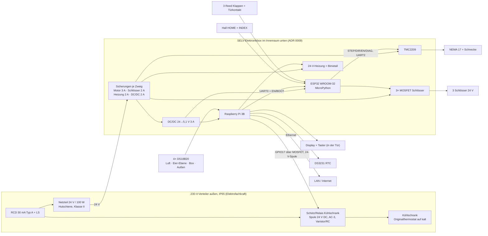
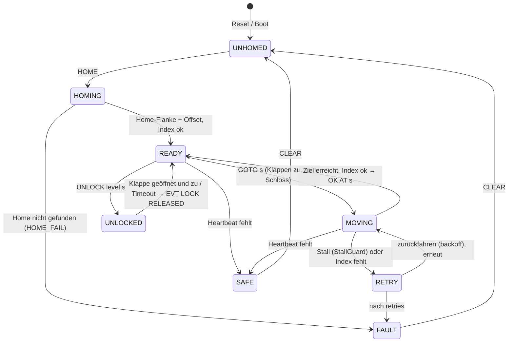
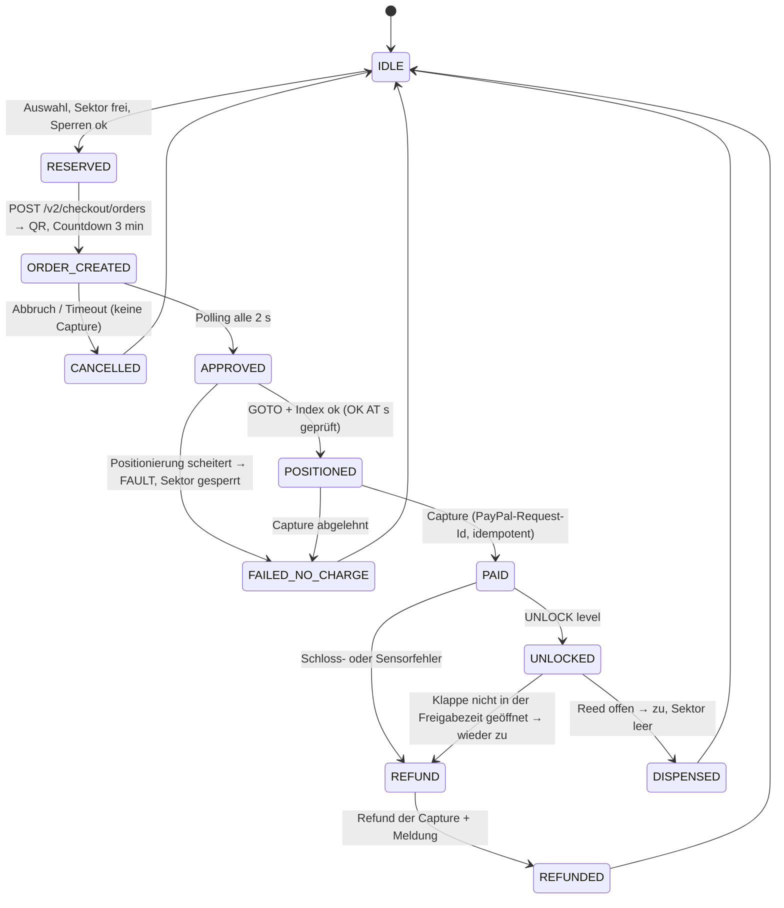

# Verkaufsautomat – Wachteleier & Honig

DIY-Verkaufsautomat auf Basis eines gebrauchten Kühlschranks. Innen sitzt ein Karussell mit 3 Ebenen, außen drei Ausgabeklappen. Bezahlt wird per PayPal-QR, gesteuert über einen Raspberry Pi 3B mit einem ESP32 als Motion-/I/O-Coprozessor.

Diese README ist der **Gesamtplan**: Aufbau, Bauablauf, Schaltpläne und Steuerlogik. Details und Begründungen stehen in den verlinkten Dokumenten. Stand: 2026-11-22.
Markierungen: ⚠️ = Risiko, 🔶 = abweichende Meinung bzw. Empfehlung gegen das Ausgangskonzept.

**Inhalt:** [1 Überblick](#1-überblick) · [2 Mechanik](#2-mechanik) · [3 Elektrik und Schaltpläne](#3-elektrik-und-schaltpläne) · [4 Steuerlogik](#4-steuerlogik) · [5 Bauablauf](#5-bauablauf) · [6 Tests und Abnahmen](#6-tests-und-abnahmen) · [7 Offene Punkte](#7-offene-punkte) · [8 Repo und Entwicklung](#8-repo-und-entwicklung)

---

## 1. Überblick

| Thema | Lösung | Quelle |
|---|---|---|
| Gehäuse | Gebrauchter Kühlschrank, Kältekreis unangetastet, Holzverkleidung mit XPS, Verflüssiger bleibt belüftet | ADR 0001 |
| Tür | Eigene Ersatztür (Multiplex + XPS) mit 3 Ausgabeklappen, Originalscharniere und -dichtung | ADR 0004 |
| Ware | Karussell, 3 Ebenen auf einer Welle, universale Sektoren: 1 Eierschachtel **oder** 1 Glas 500 g, ca. 12 Positionen bei Ø ≈ 420 mm | `cad/lib/geometry.py` |
| Antrieb | NEMA 17 + selbsthemmendes Schneckengetriebe ≈ 1:30 + TMC2209, Hall-Sensoren Home und Index | konzept.md §2 |
| Schlösser | Fail-secure-Hubmagnet mit Schnappfalle, Reed-Kontakt je Klappe | ADR 0005 |
| Steuerung | Pi 3B (Logik, Zahlung, UI, Netz) + ESP32 WROOM-32 (MicroPython, Motor, Sensoren, Schlösser, Sicherheitsinvarianten) über UART0 | ADR 0007 |
| Ort der Elektronik | SELV-Box im Innenraum unten, beheizt bei Kälte, nur Ethernet | ADR 0009 |
| Bedienung | Display ohne Touch hinter Polycarbonat, Edelstahltaster, Admin-Web-UI nur im LAN | ADR 0006 |
| Zahlung | PayPal Orders v2, nur Polling, **Capture erst nach verifizierter Positionierung** | ADR 0003 |
| Klima | Pi regelt 10–15 °C über ein Relais vor dem Kühlschrank. Winter: Kühlung aus, nur Honig. | Abschnitt 4.5 |
| Laufzeit | Docker-Container im Projektordner, Daten in `./data` | ADR 0008 |

**Sicherheitsregeln** (nicht verhandelbar, siehe [`CLAUDE.md`](CLAUDE.md)):
1. Keine Capture vor verifizierter Positionierung.
2. Schlösser sind fail-secure, jede Entriegelung ist zeitlich begrenzt.
3. Journal vor Aktion: Jeder Zustandswechsel steht in SQLite, bevor die Aktion läuft.
4. Im Zweifel zugunsten des Kunden: bezahlt, aber nicht nachweislich ausgegeben → Rückerstattung plus Meldung.
5. Verkauf nur bei synchronisierter Uhr, referenziertem Karussell, 24 V im Fenster und ohne aktiven Fehler.
6. 230 V wird nur dokumentiert, die Abnahme macht eine Elektrofachkraft. Netz- und Kleinspannung in getrennten Gehäusen.

---

## 2. Mechanik

```
           Seitenansicht (schematisch)                     Draufsicht einer Ebene
 ┌──────────────────────────────────────┐              ┌───────────────────────┐
 │  Führungslager oben                   │              │      Rückwand         │
 │ ┌───────────── Ebene 3 ────────────┐ ║ Klappe 3     │    ╱‾‾‾‾‾‾‾‾‾‾‾╲     │
 │ │ Glas / Schachtel                 │ ║              │   ╱  S2 │  S1   ╲    │
 │ ├───────────── Ebene 2 ────────────┤ ║ Klappe 2     │  │ ─────●─────  │    │
 │ │                                  │ ║  Display     │   ╲  S3 │  S0   ╱    │
 │ ├───────────── Ebene 1 ────────────┤ ║ Klappe 1     │    ╲___________╱     │
 │ │                                  │ ║  Taster      │  Kragen ╲═════╱ Tür  │
 │ └──────────────┬───────────────────┘ ║              │        Klappe        │
 │  Drehteller-   │ Welle Ø20 Edelstahl  ║              └───────────────────────┘
 │  lager   ┌─────┴─────┐ ┌───────────┐  ║
 │          │ Schnecke + │ │Elektronik-│  ║  ← Ersatztür
 │          │ NEMA17     │ │box (SELV) │  ║
 │ Grundplatte└──────────┘ └───────────┘  ║
 └──────────────────────────────────────┘
   Kompressor / Verflüssiger außen, Verkleidung mit Luftspalt
```

- **Karussell:** Böden und Trennwände aus HDPE oder PP, Sektoreinsätze einzeln entnehmbar und spülbar. Die Trennwände reichen bis zum Rand, ein gebogener Kragen an der Türinnenseite hält den Spalt unter 8 mm. Damit kommt kein Finger in den Nachbarsektor.
- **Lager:** unten ein Drehteller-Axiallager für die Last (≈ 9 kg Ware + Eigengewicht), oben ein Führungslager.
- **Antrieb:** Schneckengetriebe selbsthemmend. Ein Kunde kann das Karussell bei offener Klappe nicht weiterdrehen. Motor mit zweitem Wellenende bzw. Handrad-Aufnahme für den Notbetrieb (F11).
- **Position:** Ein Magnet je Sektor (Index-Radius) und ein Home-Magnet auf eigenem Radius, beide Hall-Sensoren vergossen an einem Halter mit Langlöchern.
- **Elektronikbox** unten neben der Motorplatte (ADR 0009): IP54, Druckausgleichsmembran, tropfdichter Deckel, abwischbar.
- **Tür und Klappen:** XPS-Sandwich, oben angeschlagen, schließen durch Schwerkraft mit Dämpfer, umlaufend EPDM-Dichtung. Eine Ausstoßfeder öffnet beim Entriegeln ca. 5 mm. Kabel laufen als Schleife über die Scharnierseite.
- **Verkleidung:** ⚠️ Der Verflüssiger muss frei bleiben. Bei einem Skin-Condenser bekommen die Seitenwände Luftspalt plus Lüftungsöffnungen unten und oben statt XPS.
- Alle Maße stehen in [`cad/params/params.json`](cad/params/params.json), die FreeCAD-Makros lesen nur dort.

---

## 3. Elektrik und Schaltpläne

### 3.1 Blockschaltbild



Leistungsbilanz: [`electronics/power-budget.md`](electronics/power-budget.md) (typisch ≈ 9 W, Spitze ≈ 70 W → 100-W-Netzteil). Pinbelegung: [`electronics/pinout.md`](electronics/pinout.md).

### 3.2 Pinbelegung (Kurzfassung)

| ESP32 | Funktion | | Pi 3B | Funktion |
|---|---|---|---|---|
| GPIO1/3 | UART0 ↔ Pi (Protokoll, Bootloader, REPL) | | GPIO14/15 | UART `/dev/ttyAMA0` ↔ ESP32 |
| EN / GPIO0 | Reset / Boot ← Pi GPIO23/24 | | GPIO23/24 | ESP32 EN / BOOT (nur low oder hochohmig) |
| GPIO26/27/25 | TMC STEP / DIR / EN (10 kΩ Pull-up) | | GPIO2/3 | I²C: DS3231 |
| GPIO17/16 | UART2 ↔ TMC PDN_UART | | GPIO4 | 1-Wire DS18B20 |
| GPIO34 | TMC DIAG (StallGuard) | | GPIO17 | Relais Kühlschrank |
| GPIO32/33 | Hall HOME / INDEX | | GPIO22 | Heizung Elektronikbox |
| GPIO4/18/19 | Schloss 1–3 (10 kΩ Pull-down) | | GPIO27 | Innenraumheizung (optional, Q8) |
| GPIO21/22/23 | Reed Klappe 1–3 | | GPIO5/6/13/19 | Taster ◀ ▶ OK Abbruch |
| GPIO13 | Türkontakt Haupttür | | GPIO12 | Taster-LED-Ring (PWM) |
| GPIO35 | 24-V-Messung (geplant, M1) | | GPIO26 | Schlüsselschalter Service |

⚠️ Tabu am ESP32: GPIO5, 12, 14, 15 (Strapping) und 6–11 (Flash). Freie Pins: nur noch GPIO36 und 39 (reine Eingänge).

### 3.3 Teilschaltungen

**Schlossausgang (3×, ESP32 GPIO4/18/19)** – stromlos zu (fail-secure):
```
 +24 V (Sicherung 2 A) ──┬──────────────┐
                         │              │
                     Schloss-        D1 1N4007 (Kathode an +24 V)
                     spule 24 V         │
                         │              │
                         ├──────────────┘
                         │ Drain
 ESP32 GPIO ──[100 Ω]──┬─┤ Gate   Q1 Logic-Level-MOSFET (z. B. IRLZ44N)
                       │ │ Source
                   [10 kΩ]└── GND
                       │
                      GND        Pull-down hält das Schloss bei Reset, Bootloader und Flashen zu
```

**Motortreiber TMC2209:**
```
 +24 V (3 A) ──┬────────┬──────── VM  TMC2209  A1/A2/B1/B2 ── NEMA 17
               │        │                    STEP ← GPIO26
            100 µF/35 V  TVS ≈ 26 V          DIR  ← GPIO27
               │        │                    EN   ← GPIO25 ──[10 kΩ]── +3,3 V (Motor aus bei Reset)
 GND ──────────┴────────┴──────── GND        DIAG → GPIO34
                                  VIO ← 3,3 V  PDN_UART ── GPIO16 (RX) und ──[1 kΩ]── GPIO17 (TX)
```
Elko und TVS direkt am Modul. Die TVS fängt die Rückspeisung beim Bremsen ab (TMC2209 maximal 29 V).

**Sensoreingang aus dem Innenraum (Hall, Reed, Türkontakt):**
```
                 +3,3 V
                   │
                [10 kΩ]  (extern, interner Pull-up ist schwach)
                   │
 Sensor ──M8/M12──┬┴─[1 kΩ]──┬── ESP32 GPIO
 (schaltet        │          │
  nach GND)      TVS 3,3 V  100 nF
                  │          │
 GND ─────────────┴──────────┘
```
Reed: Klappe geschlossen = low. Ein Kabelbruch liest sich als „offen“ und löst einen Alarm aus, nie eine Freigabe. Hall-Sensoren mit Open-Collector-Ausgang, Versorgung nach Datenblatt.

**24-V-Überwachung (ESP32 GPIO35, ADC1):**
```
 +24 V ──[100 kΩ]──┬── GPIO35      30 V → 2,73 V (ADC mit 11 dB Dämpfung)
                   │
                [10 kΩ]  100 nF
                   │      │
 GND ──────────────┴──────┘
```

**Relais Kühlschrank (Pi GPIO17) und Heizung (Pi GPIO22)** – gleicher Treiber:
```
 +24 V ──┬──────────────┐
         │              │
   Spule Schütz K1     D 1N4007         Heizung: statt der Spule
   (im 230-V-Verteiler) │               24-V-Heizwiderstand + Bimetall
         ├──────────────┘               (öffnet bei ca. +15 °C) in Reihe
         │ Drain
 Pi GPIO ──[100 Ω]──┬─ Gate  MOSFET
                 [10 kΩ]  Source ── GND
                    │
                   GND     stromlos = Kühlschrank aus bzw. Heizung aus
```
Die K1-Kontakte liegen auf der 230-V-Seite: Schließer für Motorlast (AC-3), Varistor oder RC-Glied über den Kontakt. Die Spule und die Zuleitung sind SELV, die Trennung Spule ↔ Kontakt muss verstärkt isoliert sein (Elektrofachkraft).

**Temperaturfühler (Pi GPIO4):** DS18B20 dreiadrig, 4,7 kΩ Pull-up auf 3,3 V, 4 Fühler an einem Bus: Innen Luft (Regelung), Eier-Ebene (Verkaufssperre), Elektronikbox (Heizung), Außen (Kompressorsperre, Winter).

**Taster:** Pull-up, aktiv low, RC-Filter, Entprellung in Software.

---

## 4. Steuerlogik

### 4.1 Verantwortung

| Komponente | Aufgabe |
|---|---|
| Pi 3B (`vending`) | Kaufablauf, Journal (SQLite), PayPal, Klimaregelung, Display, Web-UI, Benachrichtigungen, Recovery |
| ESP32 (`carousel_fw`) | Schritte, Homing, Index- und Stall-Prüfung, Schlösser mit Zeitlimit, Reed und Tür, Heartbeat. Erzwingt die Sicherheitsinvarianten selbst. |
| Simulator (`vending.hal.sim`) | Führt dieselbe Firmware-Logik unter CPython aus. Tests und `--sim` prüfen damit den echten Protokoll- und Firmwarecode. |

Kette: `service_cli` / Kaufablauf → `MotionService` → `Esp32Carousel` (Zeilenprotokoll) → `SerialTransport` bzw. `SimTransport`.

### 4.2 Protokoll Pi ↔ ESP32
UART 115200 8N1, ASCII, `CMD arg…\n` → genau eine Antwort `OK …` oder `ERR <code> …`, dazwischen jederzeit `EVT …`. Spezifikation: [`docs/protocol-esp32.md`](docs/protocol-esp32.md).

| Befehl | Antwort |
|---|---|
| `PING` | `OK PONG <proto>` (Heartbeat) |
| `CFG <key> <value>` | `OK CFG <key>`, nach jedem (Re)Connect alle Werte |
| `HOME` / `GOTO <s>` | `OK AT <s>` nach Index-Prüfung |
| `UNLOCK <level> <s>` / `LOCK <level>` | `OK UNLOCKING …` / `OK LOCKED …` |
| `STATUS` | `OK STATUS homed= sector= pos= fault= flaps= locks= door=` (geplant: `v24=`) |
| `CLEAR` / `DISABLE` | Fehler quittieren / alles stromlos |

Der Pi prüft jede Antwort gegen den Befehl (Sektor im `AT`, passendes Schlüsselwort) und synchronisiert nach einem Timeout per `PING` neu. `UNLOCK` wird nie automatisch wiederholt (M1/M2).

**Invarianten auf dem ESP32:** keine Bewegung bei offener Klappe oder aktivem Schloss. Höchstens ein Schloss, zeitbegrenzt (`unlock_max_s` = 60 s). Bei Stall nach Retry oder fehlendem Index: Fault, unreferenziert, erst `CLEAR` + `HOME`. Bei Heartbeat-Verlust (`hb_timeout_s` = 10 s), Reset, Bootloader und Flashen: Motor aus, Schlösser zu.

### 4.3 Bewegung (ESP32)


Kürzester Weg, Rampen mit `accel_sps2`, Blockade wird in unter 2 s erkannt.

### 4.4 Kaufablauf (Pi, Journal vor Aktion)



Jeder Übergang wird in SQLite (WAL, `synchronous=FULL`) geschrieben, **bevor** die Aktion ausgeführt wird. Hardware-Ereignisse und Fehler kommen in eine eigene Tabelle.

**Recovery beim Boot:**

| Letzter Journal-Zustand | Aktion |
|---|---|
| RESERVED, ORDER_CREATED, APPROVED | Keine Capture. Die Order verfällt, die Reservierung wird aufgehoben. |
| POSITIONED | Order-Status abfragen. Bei COMPLETED wie PAID, sonst keine Capture. |
| PAID (nicht entriegelt) | Rückerstattung + Meldung |
| UNLOCKED, Klappe nie geöffnet | Rückerstattung + Meldung |
| UNLOCKED, Klappe war offen | Ware gilt als ausgegeben, Meldung zur Prüfung an den Betreiber |
| REFUND | Rückerstattung idempotent wiederholen |

**Verkaufsbereitschaft:** Uhr synchronisiert (NTP, RTC als Rückfall), Karussell referenziert, kein Fault, 24 V im Fenster, Haupttür zu, kein Servicemodus. Eier zusätzlich: Temperatur im Fenster, Fühler ok, Legedatum + 28 Tage nicht erreicht.

### 4.5 Temperaturregelung (Pi, `vending.climate`)

Der Pi schaltet den Kühlschrank über K1 ein und aus (Schließer, stromlos = aus). Das Originalthermostat steht auf „kalt“ und ist nur der Backstop gegen Frost. Fällt der Pi aus, geht der Kühlschrank aus und die Eier werden über die Temperaturgrenze gesperrt. Startwerte, in M3 als Parameter in `params.json`, am Gerät nachjustieren:

| Größe | Wert | Begründung |
|---|---|---|
| Regelfühler | Innen Luft | Reagiert schnell. Für die Verkaufssperre zählt der trägere Fühler auf der Eier-Ebene. |
| Einschalten | ≥ 13,5 °C | 1,5 K Reserve zur Sperrgrenze 15 °C, der Produktfühler läuft nach |
| Ausschalten | ≤ 11,0 °C | Hysterese 2,5 K, 1 K Reserve zur Sperrgrenze 10 °C für das Nachkühlen |
| Mindest-Aus-Zeit | 6 min | Druckausgleich, sonst läuft der Kompressor gegen Druck an |
| Mindest-Ein-Zeit | 5 min | Ölrückführung, kein Takten |
| Starts pro Stunde | ≤ ≈ 5 | ergibt sich aus den Mindestzeiten |
| Anlaufsperre nach Boot / Stromausfall | 6 min | Druck nach kurzem Netzausfall noch nicht ausgeglichen |
| Laufzeitalarm | > 60 min am Stück ohne Ausschaltgrenze | Tür offen, Verflüssiger verdeckt, Kältemittelverlust |
| Kälte-Alarm | Luft < 9 °C bei Relais aus | Relais klebt → Eier sperren, Meldung |
| Fühlerfehler (fehlt, CRC, 85 °C / −127 °C) | Relais aus, Eier sperren | ohne Messwert keine Kühlung |
| Außen < +10 °C | kein Start | außerhalb der Klimaklasse, Winterbetrieb |

```
jede Sekunde:
  t = Luftfühler; jetzt = monotone Uhr
  wenn Fühlerfehler                      → AUS (sofort), Eier sperren
  sonst wenn Außen < 10 °C oder Winter   → AUS (Mindest-Ein-Zeit beachten)
  sonst wenn AN  und t ≤ 11,0 und jetzt − an_seit  ≥ 5 min  → AUS
  sonst wenn AUS und t ≥ 13,5 und jetzt − aus_seit ≥ 6 min
                       und jetzt − boot ≥ 6 min             → AN
  Alarme: AN länger als 60 min; AUS und t < 9 °C
  jeder Schaltvorgang mit Grund ins Temperaturlog (SQLite)
```

**Eier-Sperre:** Eier-Ebene außerhalb 10–15 °C länger als die Verzögerung (Parameter), Fühlerfehler, Uhr nicht synchron oder ab dem 28. Tag nach dem Legen (§ 22 Abs. 3 Tier-LMHV). Honig bleibt verkaufbar.

**Heizung Elektronikbox:** Ein unter ca. +5 °C Boxtemperatur, mit Hysterese, Bimetall in Reihe. ⚠️ Gegen Kondensat zählt der Abstand Box ↔ Innenluft. Reicht die Eigenwärme des Pi nicht (72-h-Test), regelt die Heizung auf ca. +3 K über der Innenluft.

### 4.6 Service und Notbetrieb
- **Servicemodus** über Schlüsselschalter oder Web-UI: Karussell Sektor für Sektor drehen, befüllen über die Haupttür. Bei offener Haupttür sind keine Verkäufe möglich.
- **Notöffnung** ohne Strom: Haupttür mit Schlüssel öffnen, Karussell per Handrad am zweiten Wellenende drehen. Die Klappenschlösser bleiben zu, die Ware wird von innen entnommen.
- **Wiederanlauf:** Strom an → Pi bootet → Anlaufsperre Kühlschrank → Uhr synchron → `CFG` an den ESP32 → `HOME` → Recovery aus dem Journal → Verkauf frei.
- Betriebsdoku folgt in `docs/betrieb.md` (M3).

---

## 5. Bauablauf

Plan mit Checklisten: [`docs/milestones.md`](docs/milestones.md). Kurzfassung:

### M0 – Gerüst ✅
Repo, Konzept, Anforderungen, ADRs, Protokoll.

### M1 – Karussell-Prüfstand (läuft)
1. Kühlschrank-Innenmaße, Eierschachtel und Glas messen, in `params.json` eintragen, `python3 cad/lib/geometry.py` → Sektorzahl.
2. Teile nach [`docs/bom/m1.md`](docs/bom/m1.md) beschaffen. Motor mit zweitem Wellenende, Getriebe auf Selbsthemmung prüfen.
3. Grundplatte mit Drehteller-Lager, Welle, eine bis drei Ebenen, Magnete, Hall-Halter. Motor und Schnecke unter die Platte.
4. Elektronik nach Abschnitt 3 auf einem Brett: 24-V-Netzteil, Sicherungen, DC/DC, Pi, ESP32, TMC2209 (Elko + TVS), ein Schloss mit Testklappe, Reed.
5. Pi einrichten (UART, `gpio=23,24=ip,np`, Docker), ESP32 mit `flash.sh` flashen.
6. Einstellen: `home_offset_steps`, StallGuard-Schwelle, Geschwindigkeit.
7. Abnahme (Abschnitt 6). Anleitung: [`docs/assembly/m1-pruefstand.md`](docs/assembly/m1-pruefstand.md).

### M2 – Zahlung in der PayPal-Sandbox
1. PayPal-Client (OAuth, Orders, Capture, Refund, Request-Id), Secrets nur in `/data/secrets.env`.
2. Kaufzustandsmaschine mit Journal und Recovery nach Abschnitt 4.4, Ereignistabelle.
3. Display-UI (pygame auf KMS, QR mit segno, Countdown, Grundpreis €/kg), Benachrichtigungen (Kanal Q5).
4. Simulator-Tests aller Sonderfälle, zufällige Strom- und Netzausfälle, danach manuell in der Sandbox am Prüfstand.

### M3 – Einbau in den Kühlschrank
1. Kühlschrank prüfen: Modell, Klimaklasse, Verflüssigertyp (Q1). ⚠️ Kabeldurchführung im Korpus erst per Wärmebild bei laufendem Kompressor suchen (Heißgasrohr, Skin-Condenser).
2. Originaltür abbauen, Innenraum reinigen, Originalthermostat auf „kalt“.
3. CAD: Karussell, Tür (`door.py`), Klappen (`flap.py`), Verkleidung (`cladding.py`), Elektronikbox mit Maßen aus `params.json`. Rückgabesektor nur bei Q9 (b).
4. Karussell mit Antrieb auf der Grundplatte im Innenraum montieren, Elektronikbox daneben.
5. Ersatztür bauen: Rahmen, XPS, Innenplatte, Dichtung, Klappen, Schlösser, Reed, Kragen, Display, Taster, Kabelschleife zum Scharnier.
6. Durchführung für 24 V, Ethernet und K1-Steuerleitung, mit PU-Schaum abdichten.
7. 230-V-Verteiler außen (RCD, LS, Netzteil, K1) planen, **Installation und Abnahme durch die Elektrofachkraft**.
8. Verkleidung aus Holz mit XPS, Lüftung für den Verflüssiger.
9. Software: Klimaregelung nach Abschnitt 4.5, Eier-Sperren, Web-UI (Belegung, Status, Temperaturverlauf, Journal, Sperren, Reinigung), tägliche Sicherung von `./data`, Container als Dauerdienst mit Healthcheck und Host-Watchdog.
10. Inbetriebnahme und Abnahme (Abschnitt 6), `docs/betrieb.md` schreiben.

### M3b – Füllstandserkennung (optional)
Versuch an einem Fach: VL53L1X gegen ein wasserfestes Ultraschallmodul, Messung im Stillstand an der Ausgabeposition, Anschluss am Pi. Nur eine Plausibilitätsprüfung, das Journal bleibt führend.

### M4 – Feldtest
Behörden-Checkliste in [`docs/legal.md`](docs/legal.md), PayPal-Geschäftskonto, Etiketten, Kostenrechnung (BOM, PayPal-Fixgebühr, Strom → Mindestpreise). Danach 4 Wochen Betrieb und Auswertung, Wartungsplan.

---

## 6. Tests und Abnahmen

| Meilenstein | Test | Kriterium |
|---|---|---|
| M1 | `service_cli soak 500` | 0 Fehlpositionen |
| M1 | Karussell blockieren | `STALL` in < 2 s, 1 Retry, dann FAULT |
| M1 | 24 V trennen während der Fahrt | Neustart mit Referenzfahrt, Schloss blieb zu |
| M1 | Heartbeat stoppen | nach 10 s `SAFE`, Motor stromlos |
| M1 | Selbsthemmung | Karussell von Hand nicht drehbar |
| M1 | Sensoren einzeln abziehen | Fehler erkannt, kein Verkauf |
| M1 | Fail-secure beim Flashen (Oszi) | Schloss-Gates < 0,5 V, TMC-EN high |
| M2 | Sim-Tests aller Sonderfälle + ≥ 100 zufällige Strom-/Netzausfälle | keine Capture ohne Positionierung, keine doppelte Capture, bezahlt und nicht ausgegeben → Rückerstattung |
| M2 | Netz trennen in jedem Kaufzustand (Sandbox) | keine Entriegelung ohne Capture |
| M3 | 72 h Temperaturlog | Eier-Ebene im Fenster, Box über Taupunkt |
| M3 | 72 h Dauerbetrieb mit simulierten Käufen | keine unerklärten Neustarts |
| M3 | 500 Klappenzyklen je Ebene | kein Ausfall |
| M3 | Stromtrennung ≥ 2× je Journal-Zustand | korrekte Recovery |
| M3 | Fail-secure aller Klappen | stromlos zu |
| M4 | 4 Wochen Feldtest | Auswertung Fehlkäufe, Rückerstattungen, Temperatur, Kondensat |

Software-Tests laufen ohne Hardware (stdlib `unittest`, Simulator). Jede Änderung an Zahlung oder Zustandsmaschine braucht einen Simulator-Test.

---

## 7. Offene Punkte
Vollständig in [`docs/requirements.md`](docs/requirements.md) (Q1–Q9):
- Q1/Q2/Q3: Kühlschrankmodell, Innenmaße, Schachtel- und Glasmaße → endgültige Sektorzahl und Platz für die Elektronikbox.
- Q4: RCD am Standort, Elektrofachkraft.
- Q5: Benachrichtigungskanal. Q6: Preise und PayPal-Gebühren.
- Q7: Kleinmengenregel für Wachteln, Registrierung (Veterinäramt).
- Q8: Eier im Winter mit Innenraumheizung.
- Q9: Rücknahme von Honiggläsern (Box außen oder über das Karussell, Pfand, Hygiene).

Rechtliches (keine Rechtsberatung): [`docs/legal.md`](docs/legal.md).

---

## 8. Repo und Entwicklung

| Ordner | Inhalt |
|---|---|
| `cad/` | FreeCAD-Makros (parametrisch), Parameter in `cad/params/params.json`, Geometrierechner |
| `electronics/` | Pinbelegung, Leistungsbilanz, später KiCad |
| `software/` | Python-Steuerung (`vending`), ESP32-Firmware (MicroPython) mit Flash-Skript |
| `Dockerfile`, `docker-compose.yml` | Laufzeit für Entwicklung und Betrieb (ADR 0008) |
| `docs/` | Anforderungen, ADRs, Rechtliches, Meilensteine, Aufbauanleitungen, BOM |

Einstieg: [`CLAUDE.md`](CLAUDE.md) (Kontext und Konventionen), [`docs/requirements.md`](docs/requirements.md), [`docs/milestones.md`](docs/milestones.md), [`docs/adr/`](docs/adr/).

### Entwicklungsumgebung
- **Docker** (Debian-Pakete): `sudo apt install docker.io docker-compose && sudo usermod -aG docker $USER`, danach ab- und wieder anmelden. Dann `mkdir -p data && docker compose build`.
- Ohne Docker laufen nur die Tests und der Sektorrechner (stdlib).
- **Claude Code (optional):** `.claude/settings.json` aktiviert das Plugin `ponytail` und ruft bei jedem Werkzeugaufruf `graphify` auf. Ohne graphify im `PATH` erscheint bei jedem Aufruf eine Hook-Fehlermeldung. Installation: `pipx install graphifyy` (oder in eine venv), dann `/graphify .`. Fremde Skills: `.claude/skills/THIRD_PARTY.md`.

### Schnellstart (ohne Hardware)
```bash
# Sektorrechner mit den aktuellen Parametern
python3 cad/lib/geometry.py

# Tests (stdlib unittest; pytest funktioniert ebenfalls)
cd software && python3 -m unittest discover -s tests -v                                   # ohne Docker (stdlib)
docker compose run --rm vending python -m unittest discover -s tests -v             # im Container (ADR 0008)

# Servicemodus gegen den Simulator
docker compose run --rm vending python -m vending.core.service_cli --sim
```
